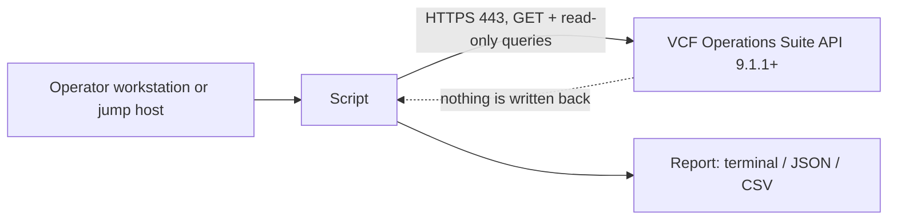

<!-- repokit:begin header -->
<picture>
  <source media="(prefers-color-scheme: dark)" srcset="docs/assets/banner-dark.svg">
  
</picture>

<p align="center">
  <a href="https://github.com/djoleradikod/vcf-operations-tool-template/releases/latest"></a>
  <a href="https://github.com/djoleradikod/vcf-operations-tool-template/actions/workflows/ci.yml"></a>
  <a href="docs/compatibility.md"></a>
  <a href="LICENSE"></a>
  <a href="pyproject.toml"></a>
</p>

<p align="center">
  <b><a href="https://djonko.dev/projects/">Project page</a></b> ·
  <a href="docs/">Documentation</a> ·
  <a href="https://github.com/djoleradikod/vcf-operations-tool-template/releases">Releases</a> ·
  <a href="https://github.com/djoleradikod/vcf-operations-tool-template/issues/new/choose">Report an issue</a>
</p>

Template Tool for VCF Operations. One sentence that says what the tool does and who it is for.

It reads from VCF Operations and never writes to it, and it runs under a read-only service account.
This is an independent community project. It is not affiliated with, endorsed by or supported by Broadcom.
<!-- repokit:end header -->

<!-- repokit:begin template-notice -->
> [!IMPORTANT]
> This repository is the template for "&lt;Tool&gt; for VCF Operations" projects. To start a new tool, choose
> *Use this template*, run `python scripts/repokit.py init --name "Your Tool"`, and follow
> [docs/template-guide.md](docs/template-guide.md). The rest of this page is the README a new tool starts with.
<!-- repokit:end template-notice -->

## Contents

- [Background](#background)
- [Design](#design)
- [Compatibility](#compatibility)
- [Quick start](#quick-start)
- [Installation](#installation)
- [Permissions (least privilege)](#permissions-least-privilege)
- [Configuration](#configuration)
- [Usage](#usage)
- [How it works](#how-it-works)
- [Troubleshooting](#troubleshooting)
- [Security](#security)
- [Contributing and support](#contributing-and-support)
- [Licence and trademarks](#licence-and-trademarks)

## Background

TODO: Two short paragraphs. Describe the operational problem in a VCF 9.x environment, who runs into
it (VI administrator, platform team, support engineer), and what an operator can do with this tool
that they could not do before. One concrete incident or scenario is worth more than a feature list.

<p align="center">
  
</p>

## Design

The tool is built to be safe to point at a production VCF Operations cluster. It only reads. The API
client accepts `GET` requests and a short, reviewed list of `POST` endpoints that query data; any
other call is rejected before a request is built, so a coding mistake cannot turn into a change in
your environment. The server enforces the same boundary through the read-only role described
[below](#permissions-least-privilege). Either control on its own would be enough to stop a write; we
keep both because they fail independently.

Credentials are handled the way an operations team would expect. The password is read from the
environment or an interactive prompt and is never accepted as a command-line flag, so it does not
end up in shell history or in a process listing. The session token is released when the tool exits
and is never written to a log. TLS verification is on unless you turn it off explicitly.

The tool is also careful with the server it reads from. Requests are made one at a time. Lists are
read in pages of 500 objects by default, so a large inventory costs a predictable number of small
requests instead of one large one. When VCF Operations answers that it is busy (HTTP 429, 502, 503
or 504), or a connection fails, the request is retried at most three times with exponential backoff
and jitter, and a `Retry-After` header from the server is respected. A request that times out while
the server is working on it is not retried, because sending the same slow query again adds load to a
cluster that is already struggling.

Every release is published with SHA-256 checksums, a software bill of materials and a signed
build-provenance attestation, so you can confirm that the file you copy to a jump host is the file
that was built from this repository.

TODO: one paragraph on the design decisions specific to this tool, such as which data it reads,
how often it is meant to run, and what it deliberately does not do.

## Compatibility

<!-- repokit:begin compatibility -->
The baseline is VCF Operations 9.1.1 or later. VCF 9.1.1 updated the open-source dependencies that adapters run on, and management packs built with earlier versions of Management Pack Builder stop collecting after the upgrade ([KB 454434](https://knowledge.broadcom.com/external/article/454434)). Every tool in this family targets 9.1.1 and later so there is one baseline to test.

| Tool release | VCF Operations | VCF | Status | Notes |
| --- | --- | --- | --- | --- |
| 0.1.x | 9.1.1 | 9.1 | Tested | Lab-validated on a single-node deployment. |
| 0.1.x | 9.0.x | 9.0 | Not supported | Below the 9.1.1 baseline. |
| 0.1.x | 8.18.x | 5.2 | Not supported | VMware Aria Operations. Below the baseline. |

The status definitions, the full history and the support policy are in [docs/compatibility.md](docs/compatibility.md). If you run the tool on a version that is not listed, please [file a compatibility report](https://github.com/djoleradikod/vcf-operations-tool-template/issues/new?template=compatibility_report.yml); that is how rows move from untested to supported.
<!-- repokit:end compatibility -->

## Quick start

```sh
# Install the wheel from the latest release (verify it first, see Installation)
pipx install ./template_tool_for_vcf_operations-*.whl

export VCFOPS_HOST=ops.rainpole.io
export VCFOPS_USER=svc-template-tool
template-tool check            # prompts for the password, confirms access and version
template-tool inventory --resource-kind VirtualMachine --limit 20
```

If you look after more than one VCF Operations deployment, describe each one once in a
[profile file](#configuration) and switch with `--profile prod`.

## Installation

| Method | When to use it |
| --- | --- |
| `pipx install <wheel from Releases>` | Recommended. Isolated, and the wheel can be [verified](#verify-a-download) first. |
| `pip install <wheel>` in a virtual environment | When pipx is not available. |
| `pip install -e ".[dev]"` from a clone | Development. See [CONTRIBUTING.md](CONTRIBUTING.md). |

Air-gapped jump host? Download the wheel and `SHA256SUMS` from [Releases](../../releases), copy both
across, verify, then `pipx install ./template_tool_for_vcf_operations-*.whl`. The only runtime
dependency is `requests` (and `tomli` on Python 3.10, which has no built-in TOML parser).

### Verify a download

```sh
sha256sum --check --ignore-missing SHA256SUMS
gh attestation verify template_tool_for_vcf_operations-*.whl --repo djoleradikod/template-tool-for-vcf-operations
```

## Permissions (least privilege)

<!-- repokit:begin permissions -->
The tool only reads. It runs under a dedicated service account with a read-only role and never needs an administrator account.

| Item | Requirement |
| --- | --- |
| Account | A dedicated service account, local or from your identity source. Not a person's account, and not an administrator. |
| Role | The built-in ReadOnly role, or a custom role cloned from it. |
| Scope | The objects the tool reports on. Narrow it to specific object types if your security model requires it. |

The role needs these permissions and no others:

| Area | Access | Why it is needed |
| --- | --- | --- |
| Suite API | Read | Acquire a session token and read the product version. |
| Objects in the account's scope | Read | List objects with their type, adapter and health (inventory command). Objects outside the scope are not returned. |

The tool does not need any of the following. Treat a request for them as a bug.

- Administrator or any built-in admin role
- Write access to policies, alerts, dashboards or adapters
- Shell or SSH access to any appliance
- vCenter, NSX or SDDC Manager credentials

Network flows:

| From | To | Port | Purpose |
| --- | --- | --- | --- |
| Machine running the tool | VCF Operations (cluster FQDN or load balancer) | 443/TCP | Suite API over HTTPS. TLS verification is on by default. |

How to create the service account and role: [docs/permissions.md](docs/permissions.md).
<!-- repokit:end permissions -->

## Configuration

Settings come from four places. A command-line flag wins over a `VCFOPS_*` environment variable,
which wins over the selected profile, which wins over the built-in default. The same variables and
the same profile file work for every tool in this family, so a deployment is described once.

### Profiles

Most operators look after more than one deployment: a lab, pre-production, production. A profile
file holds one named entry for each. It lives at `~/.config/vcfops/config.toml` on Linux and macOS
and at `%APPDATA%\vcfops\config.toml` on Windows, or wherever `VCFOPS_CONFIG` points.
[examples/config.toml](examples/config.toml) is a commented starting point.

```toml
default_profile = "lab"

[profiles.lab]
host = "ops-lab.rainpole.io"
user = "svc-vcfops-ro"
ca_bundle = "~/.config/vcfops/rainpole-ca.pem"

[profiles.prod]
host = "ops.rainpole.io"
user = "svc-vcfops-ro@rainpole.io"
auth_source = "rainpole.io"
ca_bundle = "~/.config/vcfops/rainpole-ca.pem"
password_command = "pass show vcfops/prod"
```

`template-tool profiles` shows what the tool found and which profile is selected. Choose one with
`--profile NAME` or `VCFOPS_PROFILE`; otherwise `default_profile` applies.

Two things are refused in a profile file. A password or token makes the tool exit with an error,
because a config file is copied, backed up and shared in ways a secret store is not. A setting that
turns off TLS verification is also refused: `--insecure` exists only on the command line, so skipping
verification is a decision someone makes on each run, not something a file does quietly.

### Passwords

The password is taken from the first of these that is available: the `VCFOPS_PASSWORD` variable,
the profile's `password_command`, or an interactive prompt. `password_command` runs your secret
manager's command-line client without a shell and reads the first line it prints, for example
`pass show vcfops/prod` or `op read op://Infrastructure/vcfops-prod/password`. There is no password
flag, so a password never ends up in shell history or a process listing.

### Reference

| Profile key | Variable | Flag | Default | Notes |
| --- | --- | --- | --- | --- |
| | `VCFOPS_CONFIG` | `--config` | see above | Path of the profile file. |
| | `VCFOPS_PROFILE` | `--profile` | `default_profile` | Profile to use. |
| `host` | `VCFOPS_HOST` | `--host` | | FQDN of the VCF Operations cluster or its load balancer. HTTPS only. |
| `user` | `VCFOPS_USER` | `--user` | | The read-only service account. |
| | `VCFOPS_PASSWORD` | *(none)* | prompt | Deliberately has no flag. |
| `password_command` | `VCFOPS_PASSWORD_COMMAND` | | | Secret-manager command; first line of output is the password. |
| `auth_source` | `VCFOPS_AUTH_SOURCE` | `--auth-source` | `local` | Authentication source for directory accounts. |
| `ca_bundle` | `VCFOPS_CA_BUNDLE` | `--ca-bundle` | system store | PEM file with the CA chain that signed the VCF Operations certificate. |
| `timeout` | `VCFOPS_TIMEOUT` | `--timeout` | `30` | Seconds per request, 1 to 600. |
| `page_size` | `VCFOPS_PAGE_SIZE` | `--page-size` | `500` | Objects per request for list commands. |
| `max_retries` | `VCFOPS_MAX_RETRIES` | | `3` | Retries on HTTP 429, 502, 503, 504 and failed connections, 0 to 10. |
| | | `--insecure` | off | Skips TLS verification for one run. Labs only; prints a warning. |
| | `HTTPS_PROXY` / `NO_PROXY` | | | Honoured for outbound connections. |

When `--ca-bundle` is not given, the system trust store is used, or the bundle named by
`REQUESTS_CA_BUNDLE` if that variable is set. An explicit `--ca-bundle` always takes precedence.

## Usage

```text
template-tool [options] COMMAND [options]

Commands
  check       connect, confirm the account works and the version is supported
  inventory   list objects with their kind, adapter and health
  profiles    list the profiles in the config file (no connection)
  about       show the version, compatibility baseline and profile file (no connection)

Common options (before or after the command)
  --profile NAME       use a named profile
  -o, --output FORMAT  text (default), json or csv
  -v, --verbose        debug logging; credentials and tokens are never logged
```

`template-tool COMMAND --help` lists every option with examples.

### check

Run this first against a new deployment, and from monitoring if you want to know when an upgrade
moves VCF Operations outside the tested range.

```console
$ template-tool check --profile prod
[ OK ] Authenticated to https://ops.rainpole.io as svc-vcfops-ro@rainpole.io (profile prod)
[ OK ] VCF Operations 9.1.1
[ OK ] Compatibility: tested (Lab-validated on a single-node deployment.)
```

A version that is newer than anything tested prints `[WARN]`, writes a warning to stderr and still
exits 0. A version below the baseline prints `[FAIL]` and exits 5.

### inventory

Lists objects page by page. Filters are passed to the Suite API, so only matching objects cross the
network.

```console
$ template-tool inventory --resource-kind VirtualMachine --limit 3
Name    Kind            Adapter  Health  ID
------  --------------  -------  ------  ------------------------------------
app-01  VirtualMachine  VMWARE   GREEN   2f6c1c9e-0d1b-4a55-9a3e-5b1f0c7d8e21
app-02  VirtualMachine  VMWARE   YELLOW  8b0e4a7d-6c2f-4e1a-b3d9-0f5a2c6e7d14
db-01   VirtualMachine  VMWARE   RED     c4d9e2f1-7a3b-4c6d-8e0f-1a2b3c4d5e6f

Showing 3 of 412 objects. Raise --limit or narrow the filters.
```

For a spreadsheet or another tool, use CSV or JSON. Both carry every field in full; the text table
shortens long names to fit a terminal.

```sh
template-tool inventory --adapter-kind VMWARE --resource-kind HostSystem -o csv > hosts.csv
template-tool inventory --name web -o json | jq -r '.resources[] | select(.health != "GREEN") | .name'
```

CSV cells that begin with `=`, `+`, `-` or `@` are prefixed with an apostrophe. Object names come
from vCenter and other sources that many people can edit, and a spreadsheet would otherwise treat
such a name as a formula.

The account only sees the objects in its scope. If `inventory` returns fewer objects than the
VCF Operations UI shows to an administrator, compare the service account's scope with
[docs/permissions.md](docs/permissions.md) before suspecting the tool.

### Exit codes

Scripts can rely on these. They are the same in every tool in this family.

| Exit code | Meaning |
| --- | --- |
| 0 | Success |
| 1 | Unexpected error |
| 2 | Missing or invalid configuration |
| 3 | Authentication failed |
| 4 | Authenticated, but the role does not allow the call |
| 5 | VCF Operations version not supported |
| 6 | TLS certificate not trusted |
| 7 | Blocked: the call would not be read-only |
| 8 | API or network error, after retries |

TODO: replace `inventory` with this tool's own commands, one worked example each.

## How it works

<!-- repokit:begin architecture -->

<!-- repokit:end architecture -->

The client allows `GET`, and `POST` only to an explicit allowlist of endpoints that read (the session
token endpoints and query endpoints). Anything else exits with code 7 before a request is sent. The
full list of calls, and the retry and paging rules, are in [docs/architecture.md](docs/architecture.md).

## Troubleshooting

Start with `template-tool -v check`. Common causes and fixes for each exit code are in
[docs/troubleshooting.md](docs/troubleshooting.md). When you open an issue, remove host names, IP
addresses, user names and tokens from anything you paste.

## Security

Please report vulnerabilities privately through
[GitHub private vulnerability reporting](../../security/advisories/new), not in a public issue. See
[SECURITY.md](SECURITY.md) for scope and response times.

## Contributing and support

The most useful contribution is a compatibility report: if you run the tool against a version that
is not in the table, [report the result](../../issues/new?template=compatibility_report.yml), whether
it worked or not. Code changes are welcome; [CONTRIBUTING.md](CONTRIBUTING.md) explains the rules.
Support is provided on a best-effort basis, as described in [SUPPORT.md](SUPPORT.md).

<!-- repokit:begin footer -->
## Licence and trademarks

Template Tool for VCF Operations is released under the [Apache-2.0 licence](LICENSE). Copyright 2026 Jay Djonko.

This is an independent community project by [Jay Djonko](https://djonko.dev). It is not affiliated with, endorsed by or supported by Broadcom. VMware, VMware Cloud Foundation, VCF and VCF Operations are trademarks of Broadcom Inc. and/or its subsidiaries, used here only to describe compatibility. For product issues, contact Broadcom support.

<sub>More tools and write-ups at [djonko.dev](https://djonko.dev) · [Template Tool for VCF Operations project page](https://djonko.dev/projects/)</sub>
<!-- repokit:end footer -->
