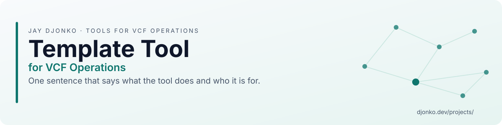
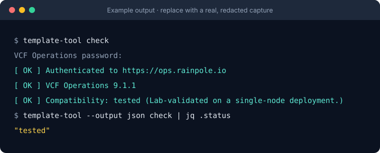
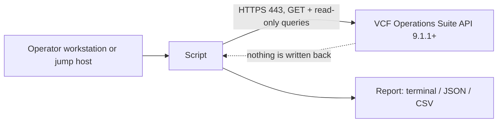

<!-- repokit:begin header -->
<picture>
  <source media="(prefers-color-scheme: dark)" srcset="docs/assets/banner-dark.svg">
  
</picture>

<p align="center">
  <a href="https://github.com/djoleradikod/vcf-operations-tool-template/releases/latest"></a>
  <a href="https://github.com/djoleradikod/vcf-operations-tool-template/actions/workflows/ci.yml"></a>
  <a href="docs/compatibility.md"></a>
  <a href="LICENSE"></a>
  <a href="pyproject.toml"></a>
</p>

<p align="center">
  <b><a href="https://djonko.dev/projects/">Project page</a></b> ·
  <a href="docs/">Documentation</a> ·
  <a href="https://github.com/djoleradikod/vcf-operations-tool-template/releases">Releases</a> ·
  <a href="https://github.com/djoleradikod/vcf-operations-tool-template/issues/new/choose">Report an issue</a>
</p>

Template Tool for VCF Operations. One sentence that says what the tool does and who it is for.

It reads from VCF Operations and never writes to it, and it runs under a read-only service account.
This is an independent community project. It is not affiliated with, endorsed by or supported by Broadcom.
<!-- repokit:end header -->

<!-- repokit:begin template-notice -->
> [!IMPORTANT]
> This repository is the template for "&lt;Tool&gt; for VCF Operations" projects. To start a new tool, choose
> *Use this template*, run `python scripts/repokit.py init --name "Your Tool"`, and follow
> [docs/template-guide.md](docs/template-guide.md). The rest of this page is the README a new tool starts with.
<!-- repokit:end template-notice -->

## Contents

- [Background](#background)
- [Design](#design)
- [Compatibility](#compatibility)
- [Quick start](#quick-start)
- [Installation](#installation)
- [Permissions (least privilege)](#permissions-least-privilege)
- [Configuration](#configuration)
- [Usage](#usage)
- [How it works](#how-it-works)
- [Troubleshooting](#troubleshooting)
- [Security](#security)
- [Contributing and support](#contributing-and-support)
- [Licence and trademarks](#licence-and-trademarks)

## Background

TODO: Two short paragraphs. Describe the operational problem in a VCF 9.x environment, who runs into
it (VI administrator, platform team, support engineer), and what an operator can do with this tool
that they could not do before. One concrete incident or scenario is worth more than a feature list.

<p align="center">
  
</p>

## Design

The tool is built to be safe to point at a production VCF Operations cluster. It only reads. The API
client accepts `GET` requests and a short, reviewed list of `POST` endpoints that query data; any
other call is rejected before a request is built, so a coding mistake cannot turn into a change in
your environment. The server enforces the same boundary through the read-only role described
[below](#permissions-least-privilege). Either control on its own would be enough to stop a write; we
keep both because they fail independently.

Credentials are handled the way an operations team would expect. The password is read from the
environment or an interactive prompt and is never accepted as a command-line flag, so it does not
end up in shell history or in a process listing. The session token is released when the tool exits
and is never written to a log. TLS verification is on unless you turn it off explicitly.

Every release is published with SHA-256 checksums, a software bill of materials and a signed
build-provenance attestation, so you can confirm that the file you copy to a jump host is the file
that was built from this repository.

TODO: one paragraph on the design decisions specific to this tool, such as how it limits load on
VCF Operations, how it handles large inventories, and what it deliberately does not do.

## Compatibility

<!-- repokit:begin compatibility -->
The baseline is VCF Operations 9.1.1 or later. VCF 9.1.1 updated the open-source dependencies that adapters run on, and management packs built with earlier versions of Management Pack Builder stop collecting after the upgrade ([KB 454434](https://knowledge.broadcom.com/external/article/454434)). Every tool in this family targets 9.1.1 and later so there is one baseline to test.

| Tool release | VCF Operations | VCF | Status | Notes |
| --- | --- | --- | --- | --- |
| 0.1.x | 9.1.1 | 9.1 | Tested | Lab-validated on a single-node deployment. |
| 0.1.x | 9.0.x | 9.0 | Not supported | Below the 9.1.1 baseline. |
| 0.1.x | 8.18.x | 5.2 | Not supported | VMware Aria Operations. Below the baseline. |

The status definitions, the full history and the support policy are in [docs/compatibility.md](docs/compatibility.md). If you run the tool on a version that is not listed, please [file a compatibility report](https://github.com/djoleradikod/vcf-operations-tool-template/issues/new?template=compatibility_report.yml); that is how rows move from untested to supported.
<!-- repokit:end compatibility -->

## Quick start

```sh
# Install the wheel from the latest release (verify it first, see Installation)
pipx install ./template_tool_for_vcf_operations-*.whl

export VCFOPS_HOST=ops.rainpole.io
export VCFOPS_USER=svc-template-tool
template-tool check            # prompts for the password, confirms access and version
```

## Installation

| Method | When to use it |
| --- | --- |
| `pipx install <wheel from Releases>` | Recommended. Isolated, and the wheel can be [verified](#verify-a-download) first. |
| `pip install <wheel>` in a virtual environment | When pipx is not available. |
| `pip install -e ".[dev]"` from a clone | Development. See [CONTRIBUTING.md](CONTRIBUTING.md). |

Air-gapped jump host? Download the wheel and `SHA256SUMS` from [Releases](../../releases), copy both
across, verify, then `pipx install ./template_tool_for_vcf_operations-*.whl`. The only runtime
dependency is `requests`.

### Verify a download

```sh
sha256sum --check --ignore-missing SHA256SUMS
gh attestation verify template_tool_for_vcf_operations-*.whl --repo djoleradikod/template-tool-for-vcf-operations
```

## Permissions (least privilege)

<!-- repokit:begin permissions -->
The tool only reads. It runs under a dedicated service account with a read-only role and never needs an administrator account.

| Item | Requirement |
| --- | --- |
| Account | A dedicated service account, local or from your identity source. Not a person's account, and not an administrator. |
| Role | The built-in ReadOnly role, or a custom role cloned from it. |
| Scope | The objects the tool reports on. Narrow it to specific object types if your security model requires it. |

The role needs these permissions and no others:

| Area | Access | Why it is needed |
| --- | --- | --- |
| Suite API | Read | Acquire a session token and read the product version. |

The tool does not need any of the following. Treat a request for them as a bug.

- Administrator or any built-in admin role
- Write access to policies, alerts, dashboards or adapters
- Shell or SSH access to any appliance
- vCenter, NSX or SDDC Manager credentials

Network flows:

| From | To | Port | Purpose |
| --- | --- | --- | --- |
| Machine running the tool | VCF Operations (cluster FQDN or load balancer) | 443/TCP | Suite API over HTTPS. TLS verification is on by default. |

How to create the service account and role: [docs/permissions.md](docs/permissions.md).
<!-- repokit:end permissions -->

## Configuration

Every setting can come from the environment, so the same variables work across all tools in this
family. Command-line flags win over environment variables.

| Variable | Flag | Default | Notes |
| --- | --- | --- | --- |
| `VCFOPS_HOST` | `--host` | | FQDN of the VCF Operations cluster or its load balancer. HTTPS only. |
| `VCFOPS_USER` | `--user` | | The read-only service account. |
| `VCFOPS_PASSWORD` | *(none)* | prompt | Deliberately has no flag, so it never lands in shell history. |
| `VCFOPS_AUTH_SOURCE` | `--auth-source` | `local` | Name of the authentication source for directory accounts. |
| `VCFOPS_CA_BUNDLE` | `--ca-bundle` | system store | PEM file with the CA chain that signed the VCF Operations certificate. |
| `VCFOPS_TIMEOUT` | `--timeout` | `30` | Seconds per request. |
| | `--insecure` | off | Skips TLS verification. Labs only; prints a warning. |
| `HTTPS_PROXY` / `NO_PROXY` | | | Honoured for outbound connections. |

## Usage

```text
template-tool [global options] COMMAND

Commands
  check    connect, confirm the account works and the version is supported
  about    show the tool version and its compatibility baseline (no connection)

Global options
  --output text|json   machine-readable output for pipelines
  -v, --verbose        debug logging (credentials and tokens are never logged)
```

| Exit code | Meaning |
| --- | --- |
| 0 | Success |
| 1 | Unexpected error |
| 2 | Missing or invalid configuration |
| 3 | Authentication failed |
| 4 | Authenticated, but the role does not allow the call |
| 5 | VCF Operations version not supported |
| 6 | TLS certificate not trusted |
| 7 | Blocked: the call would not be read-only |
| 8 | API or network error |

TODO: replace with the real commands and one worked example per command.

## How it works

<!-- repokit:begin architecture -->

<!-- repokit:end architecture -->

The client allows `GET`, and `POST` only to an explicit allowlist of endpoints that read (the session
token endpoints and query endpoints). Anything else exits with code 7 before a request is sent. The
full list of calls is in [docs/architecture.md](docs/architecture.md).

## Troubleshooting

Start with `template-tool -v check`. Common causes and fixes for each exit code are in
[docs/troubleshooting.md](docs/troubleshooting.md). When you open an issue, remove host names, IP
addresses, user names and tokens from anything you paste.

## Security

Please report vulnerabilities privately through
[GitHub private vulnerability reporting](../../security/advisories/new), not in a public issue. See
[SECURITY.md](SECURITY.md) for scope and response times.

## Contributing and support

The most useful contribution is a compatibility report: if you run the tool against a version that
is not in the table, [report the result](../../issues/new?template=compatibility_report.yml), whether
it worked or not. Code changes are welcome; [CONTRIBUTING.md](CONTRIBUTING.md) explains the rules.
Support is provided on a best-effort basis, as described in [SUPPORT.md](SUPPORT.md).

<!-- repokit:begin footer -->
## Licence and trademarks

Template Tool for VCF Operations is released under the [Apache-2.0 licence](LICENSE). Copyright 2026 Jay Djonko.

This is an independent community project by [Jay Djonko](https://djonko.dev). It is not affiliated with, endorsed by or supported by Broadcom. VMware, VMware Cloud Foundation, VCF and VCF Operations are trademarks of Broadcom Inc. and/or its subsidiaries, used here only to describe compatibility. For product issues, contact Broadcom support.

<sub>More tools and write-ups at [djonko.dev](https://djonko.dev) · [Template Tool for VCF Operations project page](https://djonko.dev/projects/)</sub>
<!-- repokit:end footer -->
