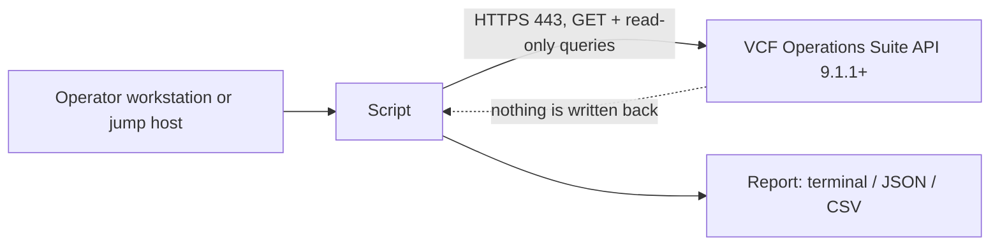

<!-- repokit:begin header -->
<picture>
  <source media="(prefers-color-scheme: dark)" srcset="docs/assets/banner-dark.svg">
  
</picture>

<p align="center">
  <a href="https://github.com/djoleradikod/vcf-operations-tool-template/releases/latest"></a>
  <a href="https://github.com/djoleradikod/vcf-operations-tool-template/actions/workflows/ci.yml"></a>
  <a href="docs/compatibility.md"></a>
  <a href="LICENSE"></a>
  <a href="pyproject.toml"></a>
</p>

<p align="center">
  <b><a href="https://djonko.dev/projects/">Project page</a></b> ·
  <a href="docs/">Documentation</a> ·
  <a href="https://github.com/djoleradikod/vcf-operations-tool-template/releases">Releases</a> ·
  <a href="https://github.com/djoleradikod/vcf-operations-tool-template/issues/new/choose">Report an issue</a>
</p>

**Template Tool for VCF Operations**: One sentence that says what the tool does and who it is for.

> [!NOTE]
> Independent community project. Not affiliated with, endorsed by or supported by Broadcom.
> Read-only by design: it never changes your environment and never needs an administrator account.
<!-- repokit:end header -->

<!-- repokit:begin template-notice -->
> [!IMPORTANT]
> **This is the template for "&lt;Tool&gt; for VCF Operations" repositories.** Press **Use this template**,
> then run `python scripts/repokit.py init --name "Your Tool"` and follow
> [docs/template-guide.md](docs/template-guide.md). Everything below is the README your tool starts with.
<!-- repokit:end template-notice -->

## Contents

- [Why this exists](#why-this-exists)
- [Highlights](#highlights)
- [Compatibility](#compatibility)
- [Quick start](#quick-start)
- [Installation](#installation)
- [Permissions (least privilege)](#permissions-least-privilege)
- [Configuration](#configuration)
- [Usage](#usage)
- [How it works](#how-it-works)
- [Troubleshooting](#troubleshooting)
- [Security](#security)
- [Contributing and support](#contributing-and-support)
- [Licence and trademarks](#licence-and-trademarks)

## Why this exists

TODO: Two short paragraphs. The operational problem in a VCF 9.x estate, who feels it (VI admin,
platform team, support engineer), and what changes once this tool is in place. Prefer one concrete
example over a list of features.

<p align="center">
  
</p>

## Highlights

- **Read-only by design.** The API client refuses any call that could change state before it leaves
  your machine. See [How it works](#how-it-works).
- **Least privilege, documented.** A dedicated service account with a read-only role. Never an
  administrator account. The exact permissions are listed [below](#permissions-least-privilege).
- **Safe by default.** TLS verification on, HTTPS only, passwords never accepted as command-line flags,
  tokens released on exit and never logged.
- **Verifiable releases.** Checksums, a software bill of materials and signed build provenance on every release.
- TODO: the two or three things that make this tool worth installing.

## Compatibility

<!-- repokit:begin compatibility -->
**Baseline: VCF Operations 9.1.1 or later.** VCF 9.1.1 updated the open-source dependencies that adapters run on, and management packs built with earlier versions of Management Pack Builder stop collecting after the upgrade ([KB 454434](https://knowledge.broadcom.com/external/article/454434)). Every tool in this family targets 9.1.1 and later so there is one baseline to test.

| Tool release | VCF Operations | VCF | Status | Notes |
| --- | --- | --- | --- | --- |
| 0.1.x | 9.1.1 | 9.1 | ✅ Tested | Lab-validated on a single-node deployment. |
| 0.1.x | 9.0.x | 9.0 | ❌ Not supported | Below the 9.1.1 baseline. |
| 0.1.x | 8.18.x | 5.2 | ❌ Not supported | VMware Aria Operations. Below the baseline. |

✅ Tested end to end by the maintainer · ☑️ Supported, reported working · ⚠️ Untested · ❌ Not supported

Full history and the support policy: [docs/compatibility.md](docs/compatibility.md). Running it somewhere not listed? [Send a compatibility report](https://github.com/djoleradikod/vcf-operations-tool-template/issues/new?template=compatibility_report.yml).
<!-- repokit:end compatibility -->

## Quick start

```sh
# Install the wheel from the latest release (verify it first, see Installation)
pipx install ./template_tool_for_vcf_operations-*.whl

export VCFOPS_HOST=ops.rainpole.io
export VCFOPS_USER=svc-template-tool
template-tool check            # prompts for the password, confirms access and version
```

## Installation

| Method | When to use it |
| --- | --- |
| `pipx install <wheel from Releases>` | Recommended. Isolated, and the wheel can be [verified](#verify-a-download) first. |
| `pip install <wheel>` in a virtual environment | When pipx is not available. |
| `pip install -e ".[dev]"` from a clone | Development. See [CONTRIBUTING.md](CONTRIBUTING.md). |

Air-gapped jump host? Download the wheel and `SHA256SUMS` from [Releases](../../releases), copy both
across, verify, then `pipx install ./template_tool_for_vcf_operations-*.whl`. The only runtime
dependency is `requests`.

### Verify a download

```sh
sha256sum --check --ignore-missing SHA256SUMS
gh attestation verify template_tool_for_vcf_operations-*.whl --repo djoleradikod/template-tool-for-vcf-operations
```

## Permissions (least privilege)

<!-- repokit:begin permissions -->
**Read-only. Needs a dedicated service account with a read-only role. Never needs an administrator account.**

- **Account:** Dedicated service account (local or from your identity source). Not a named person, not admin.
- **Role:** Built-in ReadOnly role, or a custom role cloned from it.
- **Scope:** All objects the tool reports on. Narrow it to specific object types if your security model needs it.

| Area | Access | Why it is needed |
| --- | --- | --- |
| Suite API | Read | Acquire a session token and read the product version. |

**Not required, never ask for it:** Administrator or any built-in admin role; Write access to policies, alerts, dashboards or adapters; Shell or SSH access to any appliance; vCenter, NSX or SDDC Manager credentials.

| From | To | Port | Purpose |
| --- | --- | --- | --- |
| Machine running the tool | VCF Operations (cluster FQDN or load balancer) | 443/TCP | Suite API over HTTPS. TLS verification is on by default. |

Step-by-step role and service-account setup: [docs/permissions.md](docs/permissions.md).
<!-- repokit:end permissions -->

## Configuration

Every setting can come from the environment, so the same variables work across all tools in this
family. Command-line flags win over environment variables.

| Variable | Flag | Default | Notes |
| --- | --- | --- | --- |
| `VCFOPS_HOST` | `--host` | | FQDN of the VCF Operations cluster or its load balancer. HTTPS only. |
| `VCFOPS_USER` | `--user` | | The read-only service account. |
| `VCFOPS_PASSWORD` | *(none)* | prompt | Deliberately has no flag, so it never lands in shell history. |
| `VCFOPS_AUTH_SOURCE` | `--auth-source` | `local` | Name of the authentication source for directory accounts. |
| `VCFOPS_CA_BUNDLE` | `--ca-bundle` | system store | PEM file with the CA chain that signed the VCF Operations certificate. |
| `VCFOPS_TIMEOUT` | `--timeout` | `30` | Seconds per request. |
| | `--insecure` | off | Skips TLS verification. Labs only; prints a warning. |
| `HTTPS_PROXY` / `NO_PROXY` | | | Honoured for outbound connections. |

## Usage

```text
template-tool [global options] COMMAND

Commands
  check    connect, confirm the account works and the version is supported
  about    show the tool version and its compatibility baseline (no connection)

Global options
  --output text|json   machine-readable output for pipelines
  -v, --verbose        debug logging (credentials and tokens are never logged)
```

| Exit code | Meaning |
| --- | --- |
| 0 | Success |
| 1 | Unexpected error |
| 2 | Missing or invalid configuration |
| 3 | Authentication failed |
| 4 | Authenticated, but the role does not allow the call |
| 5 | VCF Operations version not supported |
| 6 | TLS certificate not trusted |
| 7 | Blocked: the call would not be read-only |
| 8 | API or network error |

TODO: replace with the real commands and one worked example per command.

## How it works

<!-- repokit:begin architecture -->

<!-- repokit:end architecture -->

Read-only is enforced in code: the client allows `GET`, plus `POST` only to an explicit allowlist of
endpoints that read (session token and query endpoints). Anything else is refused with exit code 7
before a request is sent. Details: [docs/architecture.md](docs/architecture.md).

## Troubleshooting

Start with `template-tool -v check`. Common causes and fixes for each exit code are in
[docs/troubleshooting.md](docs/troubleshooting.md). When you open an issue, remove host names, IP
addresses, user names and tokens from anything you paste.

## Security

Please report vulnerabilities privately through
[GitHub private vulnerability reporting](../../security/advisories/new), not in a public issue. See
[SECURITY.md](SECURITY.md) for scope and response times.

## Contributing and support

Compatibility reports are the most useful contribution: if you run this against a version that is not
in the table, [tell me how it went](../../issues/new?template=compatibility_report.yml). Code
contributions are welcome too; start with [CONTRIBUTING.md](CONTRIBUTING.md). Support is
community-based and best effort, see [SUPPORT.md](SUPPORT.md).

<!-- repokit:begin footer -->
## Licence and trademarks

Template Tool for VCF Operations is released under the [Apache-2.0 licence](LICENSE). Copyright 2026 Jay Djonko.

This is an independent community project by [Jay Djonko](https://djonko.dev). It is **not affiliated with, endorsed by or supported by Broadcom**. VMware, VMware Cloud Foundation, VCF and VCF Operations are trademarks of Broadcom Inc. and/or its subsidiaries, used here only to describe compatibility. For product issues, contact Broadcom support.

<sub>More tools and write-ups at [djonko.dev](https://djonko.dev) · [Template Tool for VCF Operations project page](https://djonko.dev/projects/)</sub>
<!-- repokit:end footer -->
