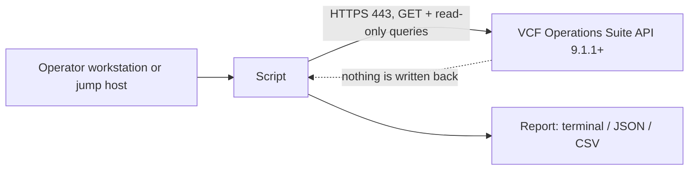

# Architecture

<!-- repokit:begin architecture -->

<!-- repokit:end architecture -->

## What the tool sends and receives

| Step | Call | Why |
| --- | --- | --- |
| 1 | `POST /suite-api/api/auth/token/acquire` | Exchange the service-account credentials for a session token. |
| 2 | `GET /suite-api/api/versions/current` | Read the product version for the compatibility check (`check`). |
| 3 | `GET /suite-api/api/resources?page=N&pageSize=M` with optional `adapterKind`, `resourceKind` and `name` | List objects, one page per request (`inventory`). |
| … | `GET` or read-only query calls | TODO: list the calls this tool adds. |
| last | `POST /suite-api/api/auth/token/release` | End the session, even when an earlier step failed. |

Nothing is sent anywhere else. There is no telemetry, no update check and no phone-home.

## Code layout

| Module | Responsibility |
| --- | --- |
| `client.py` | Transport: authentication, the read-only allowlist, TLS, retries and paging. No tool logic. |
| `config.py` | Settings from flags, environment and the shared profile file, and `password_command`. |
| `inventory.py` | The worked example of tool logic: which calls to make and what a row of output contains. |
| `output.py` | Text tables, JSON and CSV. Every command uses it, so output looks the same across tools. |
| `cli.py` | Arguments, wiring and exit codes. |
| `compat.py` | Version parsing and the compatibility verdict from `tool.yaml`. |

New commands follow the `inventory` pattern: a module that takes a client and returns rows, and a
short `cmd_*` function in `cli.py` that passes the rows to `output.emit_rows`.

## Load on VCF Operations

Requests are sequential; the tool never opens parallel connections. Lists are read in pages
(`page_size`, 500 by default), and `--limit` lowers the page size so a short listing costs one small
request.

Paging stops when the number of objects read reaches `pageInfo.totalCount`. If the server does not
report a total, paging stops at the first empty page. A page shorter than the requested size is not
treated as the end, because the server may cap the page size below what was asked for, and stopping
there would silently drop objects. A hard limit of 10,000 pages protects against a server that ignores
the page parameter.

## Retries

| Condition | Retried | Reason |
| --- | --- | --- |
| HTTP 429, 502, 503, 504 | Yes | The server or a load balancer is shedding load or restarting. |
| Connection refused, reset, or connect timeout | Yes | Nothing reached the server, so a retry costs it nothing. |
| Read timeout | No | The server is working on the request; repeating it doubles the work. |
| TLS verification failure | No | It will fail the same way every time. |
| Any other 4xx or 5xx | No | The answer will not change on its own. |

Every call the client can make is read-only, so repeating one is safe. The wait before retry *n* is
a random value between half and all of `min(30, 2^(n-1))` seconds; the jitter stops several copies
of the tool, started by the same scheduler, from retrying in step. A `Retry-After` header replaces the
computed wait. If the server asks for more than 120 seconds, the tool stops and says so instead of
waiting. `max_retries` (default 3, 0 to turn retries off) bounds the total, and each retry is logged
to stderr with the reason and the wait.

## Read-only enforcement

`src/template_tool/client.py` has one transport method. Before any request is built it checks:

- the method is `GET`, or
- the method is `POST` and the path is on `READ_ONLY_POST_PATHS` (token acquire and release, and query
  endpoints that read).

Anything else raises `ReadOnlyViolation` (exit code 7) without touching the network. Adding a path to
the allowlist is a reviewed change with its own changelog entry.

## Secrets

- The password comes from `VCFOPS_PASSWORD`, a profile's `password_command`, or an interactive
  prompt, never a flag and never the profile file.
- It is dropped from memory as soon as the token is issued.
- The token is sent only in the `Authorization` header, never logged, and released on exit.
- Debug logging (`-v`) prints methods, paths and status codes only.

## TLS

Verification is always on unless `--insecure` is passed, which prints a warning on every run. Use
`--ca-bundle` with your CA chain for internally signed certificates. There is no profile setting that
turns verification off.

The verify setting is passed with every request rather than only set on the HTTP session. `requests`
lets the `REQUESTS_CA_BUNDLE` and `CURL_CA_BUNDLE` variables override a session-level setting
([psf/requests#3829](https://github.com/psf/requests/issues/3829)), which would silently ignore
`--ca-bundle` on machines that set them. A regression test covers this.
