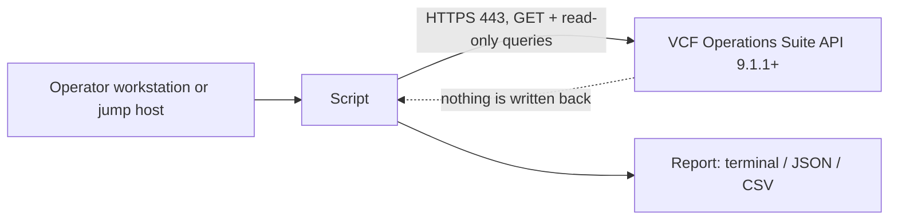

# Architecture

<!-- repokit:begin architecture -->

<!-- repokit:end architecture -->

## What the tool sends and receives

| Step | Call | Why |
| --- | --- | --- |
| 1 | `POST /suite-api/api/auth/token/acquire` | Exchange the service-account credentials for a session token. |
| 2 | `GET /suite-api/api/versions/current` | Read the product version for the compatibility check. |
| … | `GET` or read-only query calls | TODO: list the calls this tool makes. |
| last | `POST /suite-api/api/auth/token/release` | End the session, even when an earlier step failed. |

Nothing is sent anywhere else. There is no telemetry, no update check and no phone-home.

## Read-only enforcement

`src/template_tool/client.py` has one transport method. Before any request is built it checks:

- the method is `GET`, or
- the method is `POST` and the path is on `READ_ONLY_POST_PATHS` (token acquire and release, and query
  endpoints that read).

Anything else raises `ReadOnlyViolation` (exit code 7) without touching the network. Adding a path to
the allowlist is a reviewed change with its own changelog entry.

## Secrets

- The password comes from `VCFOPS_PASSWORD` or an interactive prompt, never a flag.
- It is dropped from memory as soon as the token is issued.
- The token is sent only in the `Authorization` header, never logged, and released on exit.
- Debug logging (`-v`) prints methods, paths and status codes only.

## TLS

Verification is always on unless `--insecure` is passed, which prints a warning on every run. Use
`--ca-bundle` with your CA chain for internally signed certificates.
