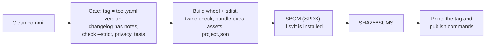

# Releasing

Releases are built on the maintainer's machine by `scripts/release.sh`. The repository has no hosted
CI. The script checks and builds; tagging and publishing stay manual commands that it prints for you.

## Cut a release

```sh
# 1. Describe the changes under "## [Unreleased]" in CHANGELOG.md
# 2. Update the compatibility matrix in tool.yaml if you tested a new combination
python scripts/repokit.py bump 1.2.0       # sets the version everywhere, dates the changelog section
git commit -am "chore(release): v1.2.0"
scripts/release.sh 1.2.0                   # or: make release VERSION=1.2.0
```

Then run the tag, push and `gh release create` commands it prints. Versions with a suffix
(`1.2.0-rc.1`) get a command that publishes a pre-release.

## What the release script does



| Asset | Purpose |
| --- | --- |
| `*.whl`, `*.tar.gz` | The Python package |
| `*-powershell.zip` | Only if the repo has a `powershell/` folder |
| `*.pak` and design files | Only for management packs, from `management-pack/dist/` |
| `project.json` | The card djonko.dev reads for the project page |
| `sbom.spdx.json` | Software bill of materials. Only if [syft](https://github.com/anchore/syft) is installed: the script warns without it, and the release notes then do not mention an SBOM |
| `SHA256SUMS` | Checksums for every asset |

The project page can always read the newest card from
`https://github.com/<owner>/<repo>/releases/latest/download/project.json`.

## Verify a release

```sh
sha256sum --check --ignore-missing SHA256SUMS
```

The checksums show that a file arrived intact and matches what was published. They come from the same
release as the files, so they do not prove who built them. Releases have no build-provenance
attestation: those are issued to GitHub Actions workflows, and this project has none. A signed
tag (`git tag -s`) is the record of who released what.

## If something goes wrong

Do not move or re-push a tag. Fix forward with a patch release (`v1.2.1`) and note the problem in its
changelog entry. If a release must be withdrawn, mark it as a pre-release and say why in its notes.
