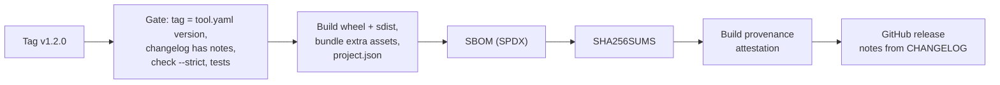

# Releasing

Releases are cut from a tag. Everything after `git push --follow-tags` is automated and repeatable.

## Cut a release

```sh
# 1. Describe the changes under "## [Unreleased]" in CHANGELOG.md
# 2. Update the compatibility matrix in tool.yaml if you tested a new combination
python scripts/repokit.py bump 1.2.0       # sets the version everywhere, dates the changelog section
python scripts/repokit.py check --strict
git commit -am "chore(release): v1.2.0"
git tag -s v1.2.0 -m "v1.2.0"               # -a if you do not sign tags
git push --follow-tags
```

Tags with a suffix (`v1.2.0-rc.1`) are published as pre-releases.

## What the release workflow does



| Asset | Purpose |
| --- | --- |
| `*.whl`, `*.tar.gz` | The Python package |
| `*-powershell.zip` | Only if the repo has a `powershell/` folder |
| `*.pak` and design files | Only for management packs, from `management-pack/dist/` |
| `project.json` | The card djonko.dev reads for the project page |
| `sbom.spdx.json` | Software bill of materials |
| `SHA256SUMS` | Checksums for every asset |

The project page can always read the newest card from
`https://github.com/<owner>/<repo>/releases/latest/download/project.json`.

## Verify a release

```sh
sha256sum --check --ignore-missing SHA256SUMS
gh attestation verify <asset> --repo <owner>/<repo>
```

Build-provenance attestations are free for public repositories. On a private repository the workflow
skips that step.

## If something goes wrong

Do not move or re-push a tag. Fix forward with a patch release (`v1.2.1`) and note the problem in its
changelog entry. If a release must be withdrawn, mark it as a pre-release and say why in its notes.
